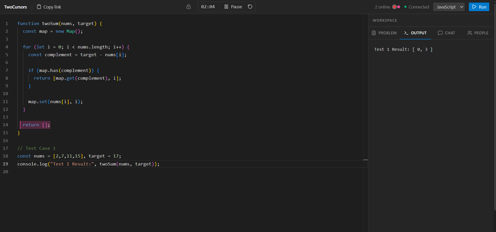
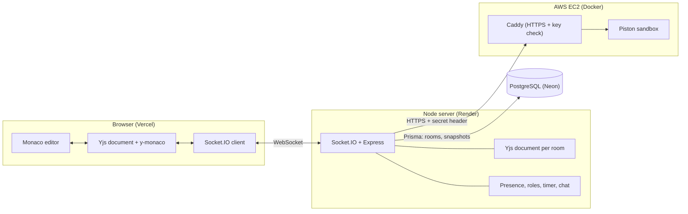
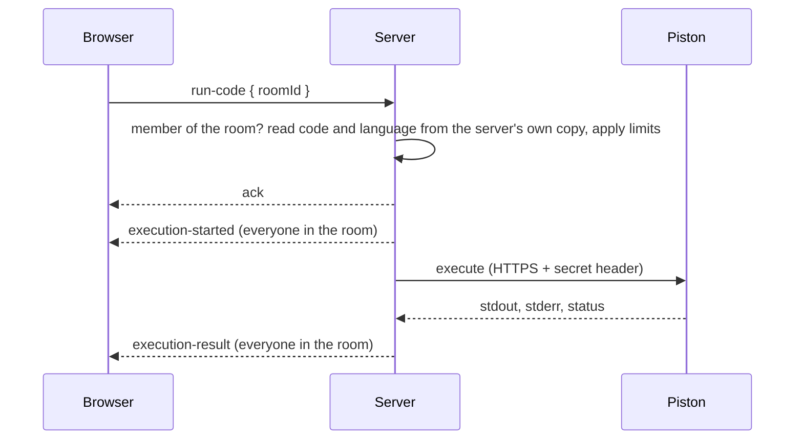

# TwoCursors

[](https://github.com/gurwindersingh777/twocursors/actions)

**A real-time collaborative code editor for mock interviews and pair programming.** Open a link, type in the same editor at the same time, see each other's cursors, and run the code together in a sandbox. No signup.

**Live demo:** https://twocursors.vercel.app





> If the backend has been idle, the first load can take up to about 30 seconds while it wakes up.

## What it does

- **Live editing.** Two or more people edit one file at once. Edits merge instead of overwriting each other, and everyone sees named, colored cursors and selections.
- **Rooms by link.** Click *Create room*, share the URL, and you are collaborating. No account needed. Display names can be changed.
- **Run code together.** JavaScript, TypeScript, Python, Java, C++, C and Go run in an isolated sandbox. The output (including compiler errors) appears for everyone in the room.
- **Interview tools.** A shared problem box, a session timer, chat with recent history, a language setting shared by the room, and a host-only *Lock editing* switch that makes everyone else read-only.
- **Survives refreshes and restarts.** Code, problem text, language and host are saved to PostgreSQL, so rejoining restores the session.
- **Handles flaky networks.** Clients reconnect and resync automatically. Edits made while offline merge when the connection returns.

## The two hard problems

1. **Conflict-free real-time sync.** Sending the whole document on every keystroke (the first version of this project did, on purpose) makes the last writer win and loses the other person's edit. TwoCursors uses a CRDT ([Yjs](https://yjs.dev)), where every character has a permanent identity, so concurrent edits merge into the same result on every screen.
2. **Running untrusted code safely.** Code from strangers runs in [Piston](https://github.com/engineer-man/piston), a Docker-based sandbox with time, output and memory limits. It sits on its own server, behind HTTPS and a secret key, and the backend decides what runs, not the browser.

## Architecture



### What happens when someone clicks Run



### Where each kind of state lives

| Data | Where | Why | Survives a server restart |
|---|---|---|---|
| Code and problem text | Yjs document, synced over Socket.IO, saved as snapshots in PostgreSQL | Needs conflict-free merging | Yes |
| Cursors and selections | Yjs Awareness, relayed and never stored | Temporary and changes constantly | No |
| Online list, roles, lock, timer, chat | Server memory (the server is the authority) | Needs rules, such as "only the host may lock" | No |
| Language and host | Server memory and PostgreSQL | Must outlive a restart | Yes |

## Tech stack

| Layer | Tools |
|---|---|
| Frontend | Next.js 16, React 19, TypeScript, Tailwind CSS 4, Monaco Editor |
| Real-time | Socket.IO (WebSocket only), Yjs, y-monaco, y-protocols |
| Backend | Node.js, Express 5, TypeScript |
| Database | PostgreSQL (Neon) with Prisma 7 |
| Code execution | Piston in Docker, behind Caddy |
| Testing and CI | Vitest, GitHub Actions |
| Hosting | Vercel (frontend), Render (backend), Neon (database), AWS EC2 (sandbox) |

## Security and limits

| Area | What is in place |
|---|---|
| Rooms | Every socket event checks that the sender really joined that room. Room ids are 16 random hex characters. |
| Permissions | The host holds a secret token; the server stores only its SHA-256 hash. *Lock editing* is enforced on the server, so a locked candidate's edits are dropped even if the browser is tampered with. |
| Running code | The server reads the code and language from its own copy of the room, not from the request. One run per room at a time, 4 at once server-wide, 10 per minute per connection, 100,000 characters maximum. |
| Sandbox | Separate server. Piston's port is bound to localhost; the public entry point is Caddy over HTTPS, which only forwards the execute endpoint and only with the right key. Piston enforces a run timeout (about 3 s) and an output cap, and its memory limits are set in `piston/docker-compose.prod.yml`. |
| Input handling | Every handler is wrapped so malformed input is logged instead of crashing the server. Yjs updates are validated before they are applied. Names, colors, chat length and room ids are validated. CORS only allows the configured origins. |

## Tests and CI

Run `npm test` in `server/`. There are 32 tests:

| Suite | Tests | What it covers |
|---|---|---|
| `logic` | 15 | Name cleaning, binary validation, language validation, Piston result formatting (including compile errors and timeouts), timer math, chat history |
| `runLimiter` | 3 | One run per room, a server-wide cap, a per-connection rate limit |
| `lifecycle` | 4 | Idle rooms are saved and freed, kept if the save fails, and cancelled if someone returns |
| `sync` (integration) | 10 | Real Socket.IO clients against the real server: concurrent edits converge, late joiners get the code, garbage updates are ignored, locked candidates cannot edit, outsiders cannot write or run code, presence stays correct, language changes never touch the code, chat history reaches late joiners |

The database is replaced by a fake in tests, so they need no connection and never touch real data.

GitHub Actions runs on every push. The server job runs `prisma generate`, a type-check and the tests. The client job runs a type-check, lint and the production build.

I also tested by hand: reconnecting after a network drop, four simultaneous editors, offline edits merging after reconnect, pasting about 200 KB of code, restarting the server mid-session, and many rapid joins and leaves.

## Run it locally

You need Node.js 20 or newer, Docker, and a PostgreSQL database (a free [Neon](https://neon.tech) database works).

```bash
git clone https://github.com/gurwindersingh777/twocursors.git
cd twocursors

# 1. Sandbox (needs Docker running)
cd piston && docker compose up -d && cd ..

# 2. Server
cd server
cp .env.example .env          # then set DATABASE_URL
npm ci
npx prisma generate
npx prisma migrate deploy
npm run dev                   # http://localhost:4000

# 3. Client (in a new terminal)
cd client
cp .env.example .env
npm ci
npm run dev                   # http://localhost:3000
```

Piston starts with no languages. Install the ones you want (this is a one-time step; they are stored on disk):

```bash
# see what this Piston can install
curl -s http://localhost:2000/api/v2/packages

# install one; repeat for python, node, typescript, java, gcc (C and C++) and go
curl -s -X POST http://localhost:2000/api/v2/packages \
  -H "Content-Type: application/json" \
  -d '{"language":"python","version":"3.12.0"}'
```

On Windows PowerShell, use `curl.exe` and put the JSON in a file, or run these in Git Bash.

### Environment variables

| Where | Variable | Purpose |
|---|---|---|
| server | `PORT` | Port to listen on (default 4000) |
| server | `CLIENT_URL` | Allowed website origins, comma-separated, no trailing slash |
| server | `DATABASE_URL` | PostgreSQL connection string |
| server | `PISTON_URL` | Where Piston is (default `http://localhost:2000`) |
| server | `PISTON_KEY` | Secret sent to a remote Piston. Leave empty locally |
| client | `NEXT_PUBLIC_API_URL` | Backend address. It is baked in at build time |

## Deployment

| Part | Where | Notes |
|---|---|---|
| Frontend | Vercel | Root directory `client`. Set `NEXT_PUBLIC_API_URL` before the first build |
| Backend | Render web service | Root directory `server`. Build `npm install && npm run build`, start `npm start`. Set the server variables above |
| Database | Neon | Run `npx prisma migrate deploy` against it once |
| Sandbox | AWS EC2 (Ubuntu 24.04, x86_64, 2 GB RAM) | Docker, using `piston/docker-compose.prod.yml` |

**Why the sandbox has its own server.** Piston needs a privileged Docker container and a host with cgroup v2, which most platform-as-a-service hosts do not allow. It also has no login of its own, so it must never be exposed directly.

The production setup runs Piston and Caddy together. Create `piston/.env` with `PISTON_HOST` (a hostname pointing at the server, for example `<ip-with-dashes>.sslip.io`, which needs no domain purchase) and `PISTON_KEY` (a long random string). Then:

```bash
cd piston
docker compose -f docker-compose.prod.yml up -d
```

Install the runtimes as shown above (against `127.0.0.1:2000` on that server), then set `PISTON_URL=https://<that hostname>` and the same `PISTON_KEY` on the backend.

## Project structure

```
.
├── client/                 Next.js app
│   └── src/
│       ├── app/            Pages
│       ├── components/     Editor, header, side panel, chat, timer, people
│       ├── hooks/          Connection, shared document, room state, code execution, remote cursors
│       └── lib/            Socket, Yjs sync and awareness, helpers
├── server/
│   ├── prisma/             Schema and migrations
│   ├── src/
│   │   ├── socket/         Socket.IO wiring and one handler file per feature
│   │   ├── rooms/          Per-room state: presence, roles, timer, language, chat, lock
│   │   ├── services/       Piston client, persistence, autosave, room cleanup, run limiter
│   │   └── yjs/            The server's copy of each room's document
│   └── tests/              Unit and integration tests
├── piston/                 Sandbox setup (local and production with Caddy)
└── .github/workflows/      CI
```

## Real-time protocol

Client to server: `join-room`, `leave-room`, `yjs-update`, `awareness-update`, `run-code`, `set-language`, `send-chat-message`, `start-timer`, `pause-timer`, `reset-timer`, `request-interviewer-mode`, `rename-user`.

Server to client: `yjs-sync`, `yjs-update`, `awareness-update`, `awareness-request`, `awareness-remove`, `presence-state`, `interview-role`, `language-state`, `timer-state`, `interviewer-mode-state`, `chat-history`, `chat-message`, `execution-started`, `execution-result`, `join-error`.

On join, the server pushes the whole room state (role, language, timer, lock, chat, then the document), so the order in which events arrive never matters. The document comes last, and the client treats it as "the room is ready".

## Design decisions and lessons

- **Naive sync first, on purpose.** The second version of the project sent the whole document on every change, to see the overwrites and cursor jumps firsthand before adding Yjs.
- **Three places for shared state.** Content that must merge goes in the Yjs document. Temporary per-person data goes in Awareness. Anything with rules goes in server-owned state, because a CRDT cannot say "only the host may write this".
- **The server is the authority.** Read-only mode, room membership, and what gets executed are decided on the server. The browser only asks.
- **Bugs that shaped the design:**
  - The online list built from Awareness disagreed between tabs when several people joined and left, so it became a single list owned and broadcast by the server.
  - Inserting starter code from the browser duplicated text when two clients did it at once, and the CRDT faithfully kept both. It was removed, and a regression test now checks that switching language never touches the code.
  - Hard-coding a Python version broke Run when the server had a different one installed. The backend now asks Piston for the newest installed version.
  - A timer that mixed the server's clock with each browser's clock was wrong whenever the clocks differed. The server now sends its own time, and each browser corrects for the difference.

### Scope decisions

- **Redis.** Presence uses an in-memory map; this is swappable for Redis pub/sub if scaled across multiple server instances.
- **Authentication.** Auth was intentionally left out of the MVP to keep the room-join flow frictionless; GitHub OAuth via NextAuth would be the natural next step for persistent session history.

## Known limitations

- **One server instance.** Room state lives in memory, so scaling out would need Redis or similar. A restart resets the timer, lock and chat; code, language and host survive.
- **Offline edits are lost if the page is refreshed before reconnecting**, because the browser's copy of the document is only in memory.
- **The host is tied to one browser.** The host secret lives in that browser's local storage. Rooms made with *Create room* have a host; a hand-typed link has none until someone presents a token.
- **Lock editing covers the code and problem only**, not running code, the language, the timer or chat.
- **Java classes must be named `Main`.**
- **Single messages are limited to 5 MB**, so a very large paste is rejected.
- **The sandbox is reachable from the internet.** It is protected by a secret header, rate limits and Piston's own isolation, but it is a privileged container, so it deserves its own machine with nothing else valuable on it.
- **No accounts.** A display name is only remembered per browser tab.

## Roadmap

- A small problem library with starter code per language, written so that a single writer inserts it.
- A recovery link for the host, for new devices.
- Redis-backed presence for multiple server instances.
- GitHub login and a history of past sessions.
- Offline persistence of the browser's document, using `y-indexeddb`.
- Deleting rooms that have been idle for a long time.